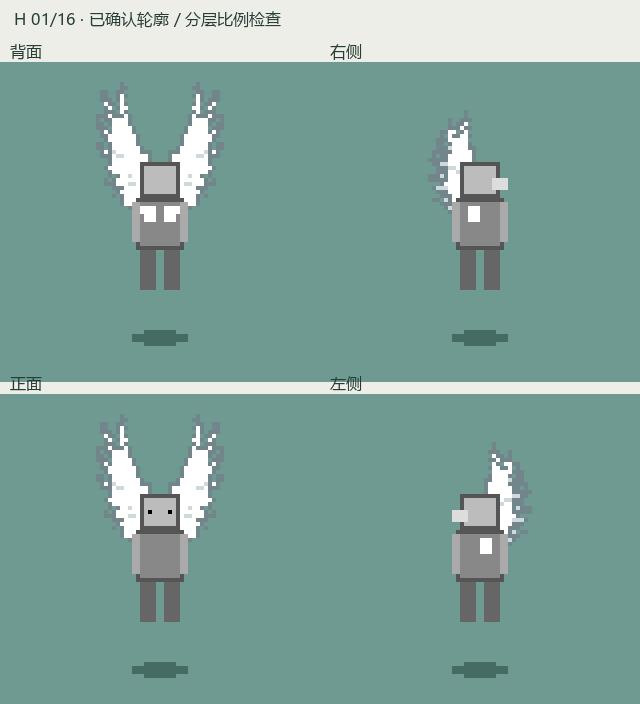
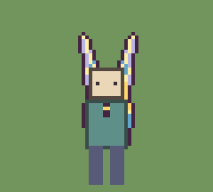

# Angel Wings · 天使羽翼

为《星露谷物语》添加永久飞行、天使翅膀与蝴蝶、海莉花海任务，以及可以挂在墙上并交换的备用翅膀。

A single-player SMAPI mod for Stardew Valley, featuring permanent flight, angel and amber butterfly wings, Haley's flower quest, and wall-mounted spare wings. English and Simplified Chinese are included.

**当前版本：0.4.13 Alpha。** 面向玩家的 Formal 构建采用海莉 **8 心／369 株花**规则；源码默认的 QuickTest 构建采用 **3 心／0 株花**，用于开发测试。两者共用同一个模组 ID，只能安装其中一份。

## 功能

- 在帽子老鼠商店花 **1000 金**购买天使翅膀，为当前角色永久解锁飞行。佩戴中的翅膀不占背包或装备格。
- 支持起飞、悬停、移动、降落、过门收翼和水面特效，可越过已支持的水面与低围栏，并保留正常互动、工具和钓鱼规则。
- 完成海莉的花海任务，获得琥珀蝶翼；两种外观共用同一飞行能力。
- 落地后可在背包中右键换翼，或与墙上存放的备用翅膀交换。
- 可选兼容 **Swim - Continued 1.9.0**：在水面切换游泳与飞行；潜水时须先返回水面才能起飞。

## 素材预览

以下为当前素材的离线动画导出，**不是游戏内截图或实机验收记录**。

| 天使翼 | 琥珀蝶翼 |
| --- | --- |
|  |  |

## 运行要求与安装

- 构建和检查环境：Windows、《星露谷物语》**1.6.15**、**SMAPI 4.5.1 或更新版本**。
- 仅支持单人游戏；联机、分屏、其他平台与其他游戏版本未经验证。
- 自带英文和简体中文。基础飞行不需要安装 Swim 或额外内容包。
- Swim 兼容针对 1.9.0；其物品和潜水地图内容包仍需按 Swim 自身说明安装依赖，不随本模组提供。

玩家请使用 GitHub **Releases → Assets** 中单独附加的安装包。当前准备的文件名为 `AngelWings-0.4.13-Nexus-Minimal.zip`，它也是可用于 GitHub 分发的完整 SMAPI 安装包。若尚无 Release，表示尚未提供公开下载。

1. 退出游戏与 SMAPI，备份存档和已有配置。
2. 解压安装包，将其中的 `AngelWingsVisualPreview` 文件夹放进游戏的 `Mods` 目录。
3. 更新时替换同一模组目录中的文件，保留原 `config.json`，通过 SMAPI 启动游戏。
4. 旧天使翼版、Formal 与 QuickTest 使用同一个 ID，不要并排安装。

## 默认操作

| 操作 | 键盘 | 手柄 |
| --- | --- | --- |
| 召唤翅膀／起飞／降落 | F8 | 轻按左摇杆 L3 |
| 应急恢复 | F10 | 飞行时长按 L3 1.2 秒 |

默认飞行移速为普通移动的 **1.65 倍**。个人配置中的按键和参数优先；首次启动后生成 `config.json`，可退出游戏后编辑。落地时也可在 SMAPI 控制台运行 `angelwings_reload` 重新读取配置。

墙壁、锁门与实体障碍仍会阻挡飞行。基础飞行需要安全地面才能降落；启用受支持的 Swim 后，水面可以交回游泳。飞行不提供无敌或免体力。

## 海莉花海任务与换翼

Formal 构建的流程如下：

1. 已购买飞行、海莉达到 **8 心**且任务从未触发时，在符合条件的**春季早晨**收到来信。读信接受任务，无完成期限。
2. 在**主农场室外与温室地面**合计保有 **369 株同时可采摘的成熟花卉作物**。花盆、姜岛、背包或箱子里的花、枯死及未成熟作物不计入。
3. 一次检查达到数量后，可交付状态会保存；随后采花不会取消资格，也不消耗花朵。
4. 与海莉正常对话，读完三个对话框；关闭第三页才完成任务并领取琥珀蝶翼。背包满时使用原版物品领取菜单。

奖励不会自动换装。落地后，在背包页右键备用翅膀，会把它与当前佩戴外观原格交换；对墙上的翅膀按操作键，也会在原墙位交换。备用翅膀属于不可堆叠的墙面家具，起降和飞行途中不能换翼。

由 QuickTest 切换到 Formal **不会重置已经接取、达标或完成的任务**。从头测试正式流程请使用未触发任务的独立存档。

## 从源码开发

开发环境：

- **.NET 8 SDK 或支持 C# 12 的更新 SDK**，以及用于运行游戏程序集检查的 **.NET 6 Runtime**。项目目标框架是 `net6.0`。
- 本地游戏与 SMAPI 安装，构建通过 `GamePath` 引用其程序集；游戏文件、SMAPI、Harmony 和第三方模组 DLL 不随源码分发。
- **Python 3.11 或更新版本**，安装 [开发依赖](requirements-dev.txt)。美术工具目前按 Windows 环境编写，部分检查图使用微软雅黑字体。

在项目根目录运行 PowerShell，先修改自己的游戏路径：

```powershell
$gamePath = 'C:\Games\Stardew Valley' # 改为本机安装目录
python -m pip install -r requirements-dev.txt

# 仅执行正式规则的离线回归与游戏接口检查，不安装、不生成发布 ZIP。
./validate-flight.ps1 -Profile Formal -GamePath $gamePath

# 首次从干净源码构建完整正式规则包，包含美术检查、编译和打包。
./build-preview.ps1 -Profile Formal -GamePath $gamePath
```

| Profile | 版本 | 海莉条件 | 暂存目录 |
| --- | --- | --- | --- |
| `Formal` | `0.4.13` | 8 心／369 株 | `build/formal/AngelWingsVisualPreview` |
| `QuickTest`（默认） | `0.4.13-quick-test` | 3 心／0 株 | `build/AngelWingsVisualPreview` |

构建不会安装模组。已有同版本 ZIP 时，构建脚本会拒绝覆盖；仅复查请运行 `validate-flight.ps1`，改变代码或资源后重新发布须先递增版本。

如需检查可选 Swim 兼容，自行取得原版 Swim 1.9.0 DLL 后运行：

```powershell
./tools/validate-swim-compat.ps1 -Profile Formal -GamePath $gamePath -SwimDllPath 'C:\Path\To\Swim.dll'
```

卡住时按 F10 或运行 `angelwings_recover`；`angelwings_status` 可输出诊断。反馈问题请附版本、复现步骤、地图位置和 SMAPI 日志，并在分享前移除不希望公开的个人信息。

卸载前请在安全地面落地，正常保存、退出并备份存档，再移除模组目录。备用翅膀属于自定义家具，移除模组后可能无法继续使用。

